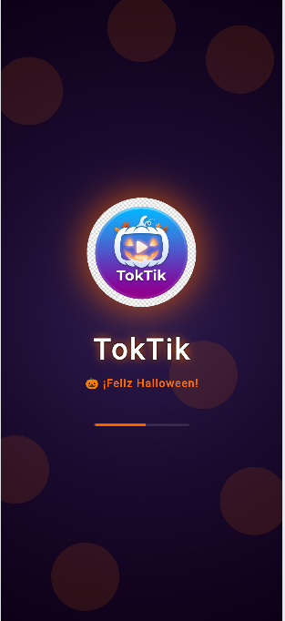
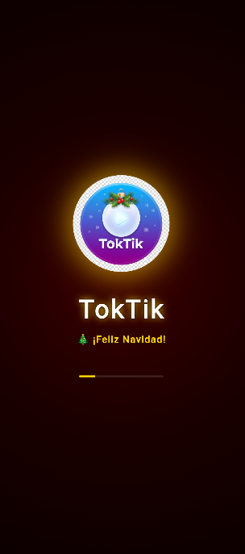
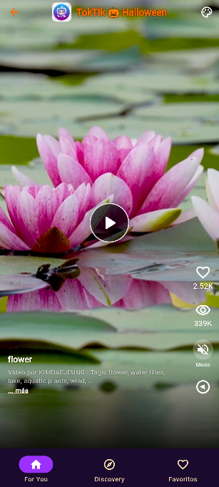
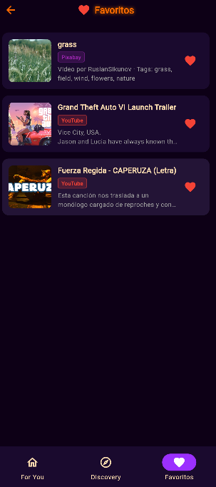
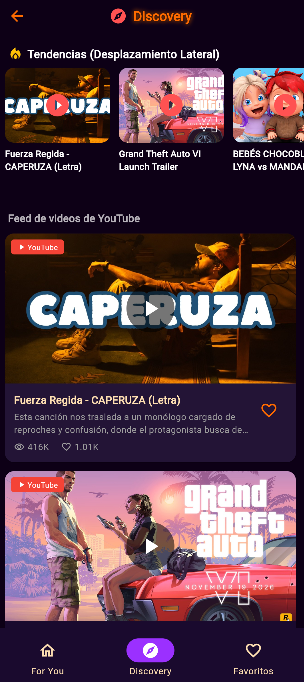

# Práctica 04 — TokTik: Video App - Reproducción automática de videos

**Materia:** Desarrollo Móvil Integral  
**Número de control:** 230040  
**Fecha:** Octubre 2026

---

## Descripción

Aplicación móvil desarrollada en Flutter inspirada en TikTok. Permite reproducir videos de forma automática en pantalla completa con desplazamiento vertical. Incluye sistema de temas estacionales que adapta colores e ícono de la app dependiendo del mes del año, y un filtro lógico que excluye videos con datos inconsistentes (más likes que visualizaciones).

---

## 📸 Evidencia de Funcionalidades

> Las siguientes capturas muestran las funcionalidades implementadas corriendo en el dispositivo.

| Captura | Funcionalidad demostrada |
|:---:|---|
|  | **Splash Screen — Octubre (Halloween)** · Pantalla de bienvenida de 3 segundos con logo temático de Halloween, resplandor naranja-morado, texto `¡Feliz Halloween!` y barra de progreso. Se reproduce el audio `OctubreP4.mpeg` al iniciar. |
|  | **Splash Screen — Diciembre (Navidad)** · Splash navideño con logo temático, fondo rojo oscuro, resplandor dorado y texto `¡Feliz Navidad!`. Se reproduce el audio `DiciembreP4.mpeg` al iniciar. |
|  | **Botón Central Play/Pause + Ícono Estacional** · Botón circular visible en el centro de la pantalla con icono de pausa/play. Se muestra al tocar el video y se oculta automáticamente (1.5 s). El AppBar muestra el ícono de Halloween cuando `month == 10`. |
|  | **Guardar Favoritos con Like** · Al presionar ❤️ en cualquier video (local, Pixabay o YouTube), el video se almacena en `SharedPreferences` y aparece en la pestaña **Favoritos** con miniatura, fuente y descripción. |
|  | **Discovery — YouTube Data API v3** · Pestaña Discovery cargando videos reales de YouTube: carrusel horizontal de tendencias + feed vertical detallado. Cada tarjeta muestra miniatura, título, vistas, likes y botón de favorito. |

---

### 🌐 Visor de Diagramas de Arquitectura (GitHub Pages)

> ### 🚀 **[🌐 Abrir Visor de Arquitectura Completo (HTML Interactivo)](https://danny88e.github.io/Practicas-DMI-230040/Practica%204/TokTik/architecture-diagram.html)**
>
> Aplicación web interactiva que fusiona en un solo visor ambos diagramas de arquitectura del proyecto, con partículas animadas de fondo, efectos hover en los nodos e inspector de código:
>
> - 🟢 **[Diagrama 1: Flujo de Videos Locales (Provider Directo)](https://danny88e.github.io/Practicas-DMI-230040/Practica%204/TokTik/architecture-diagram.html#local)**  
>   *Modo offline, 14 assets locales, filtro lógico `isValid` (likes &le; views) y persistencia en `SharedPreferences`.*
> - 🟣 **[Diagrama 2: Flujo con APIs Externas (Clean Architecture & DataSources)](https://danny88e.github.io/Practicas-DMI-230040/Practica%204/TokTik/architecture-diagram.html#api)**  
>   *Inversión de dependencias (SOLID DIP), orquestador multi-fuente (`Dio`), YouTube Data API v3, Pixabay Video API y Pexels.*
> - 🌐 **[Abrir Visor de Arquitectura Completo (HTML Interactivo)](https://danny88e.github.io/Practicas-DMI-230040/Practica%204/TokTik/architecture-diagram.html)**  
>
> *Realizado por: **Luis Daniel Suarez Escamilla 230040** — 10A IDGS*

---

## Funcionalidades

- **Splash Screen de 3 segundos con sonido estacional**:
  - 🎃 **Octubre**: Logo Halloween (`Logo_TokTik_Octubre.jfif`) + audio temático (`OctubreP4.mpeg`).
  - 🎄 **Diciembre**: Logo Navideño (`Logo_TokTik_Diciembre.jfif`) + audio navideño (`DiciembreP4.mpeg`).
  - 💝 **Febrero**: San Valentín con paleta rosa/carmesí.
  - 📱 **Resto del año**: Logo estándar TokTik.
- **Mecanismo de Prueba de Temporadas**: Botón interactivo en el AppBar que permite forzar cualquier temporada y la persiste en `SharedPreferences`.
- **Botón de Silenciar/Activar Sonido (Mute/Unmute)**: Ubicado en la columna lateral derecha de interacción del video con `ValueNotifier`.
- **Botón Central Play/Pause Visible**: Botón circular interactivo con fondo translúcido y borde que muestra claramente el ícono de Pausa durante la reproducción y de Play al estar pausado, permitiendo alternar la reproducción con un tap.
- **Descripción Extensa con Desplazamiento Vertical**: Botón `... más` que despliega un contenedor scrollable vertical (`SingleChildScrollView` con scrollbar).
- **Desplazamiento Lateral**: Navegación horizontal fluida (`PageView` lateral) entre **For You**, **Discovery** y **Favoritos**, además de un carrusel horizontal en Discovery.
- **Persistencia de Likes y Vistas**: Almacena el número exacto de likes y vistas en `SharedPreferences` persistiendo al reiniciar la app.
- **3 DataSources Externos**: Consumo de videos mediante **YouTube Data API v3**, **Pexels Videos API** y **Pixabay Video API** bajo principios de Clean Architecture.
- **Filtrado de videos ilógicos**: Exclusión automática de videos donde `likes > views`.

---

## Tecnologías

| Tecnología | Uso |
|---|---|
| Flutter / Dart | Framework móvil |
| Material Design 3 | UI y sistema de temas dinámicos |
| `provider` ^6.1.5 | Gestión de estado reactivo |
| `video_player` ^2.9.1 | Reproductor de videos MP4 (local y red) |
| `audioplayers` ^6.1.0 | Reproducción de audios estacionales en Splash |
| `youtube_player_flutter` ^9.1.1 | Reproductor embebido de YouTube |
| `dio` ^5.4.0 | Cliente HTTP para APIs de Pexels, Pixabay y YouTube |
| `shared_preferences` ^2.3.2 | Persistencia de likes, vistas, favoritos y temporadas |
| `cached_network_image` ^3.4.1 | Caché de miniaturas remotas |
| `animate_do` ^3.3.4 | Animaciones fluidas |
| `intl` ^0.19.0 | Formato numérico compacto (K, M) |

---

## Estructura del proyecto

```
lib/
├── main.dart                            ← Entrada de la app + tema estacional
├── config/
│   ├── helpers/
│   │   └── human_formats.dart           ← Formato numérico compacto (K, M)
│   └── theme/
│       └── app_theme.dart               ← Temas Halloween / Navidad / Normal
├── domain/
│   └── entities/
│       └── video_post.dart              ← Entidad VideoPost + getter isValid
├── infrastructure/
│   └── models/
│       └── local_video_model.dart       ← Modelo de datos locales
├── shared/
│   └── data/
│       └── local_video_posts.dart       ← Lista de 14 videos con datos
└── presentation/
    ├── providers/
    │   └── discover_provider.dart       ← Estado + filtrado de videos ilógicos
    ├── screens/
    │   └── discover/
    │       └── discover_screen.dart     ← Pantalla principal con ícono dinámico
    └── widgets/
        ├── shared/
        │   ├── video_scrollable_view.dart ← PageView vertical de videos
        │   └── video_buttons.dart         ← Botones likes / vistas / disco
        └── video/
            ├── fullscreen_player.dart     ← Reproductor a pantalla completa
            └── video_background.dart      ← Gradiente oscuro sobre el video
```

---

## Videos — Descarga desde Google Drive

> Los archivos de video **no están incluidos en el repositorio** porque algunos superan el límite de 100 MB de GitHub (`7.mp4` = ~112 MB).

📁 **Carpeta de Drive con todos los videos:**  
👉 [https://drive.google.com/drive/folders/1UIfiS2BddDjaQhLNDF1gzXh5rHRjgOhO?usp=sharing](https://drive.google.com/drive/folders/1UIfiS2BddDjaQhLNDF1gzXh5rHRjgOhO?usp=sharing)

Antes de ejecutar la app, descarga los 14 videos y colócalos en:
```
Practica 4/TokTik/assets/videos/
```
Los archivos deben nombrarse exactamente: `1.mp4`, `2.mp4`, ..., `14.mp4`

---

## Cómo ejecutar

```bash
# 1. Descarga los videos desde Drive y colócalos en assets/videos/

# 2. Entra a la carpeta del proyecto:
cd "Practica 4/TokTik"

# 3. Instalar dependencias
flutter pub get

# 4. Ejecutar en dispositivo o emulador
flutter run

# Ejecutar en Chrome (web)
flutter run -d chrome
```

---

## Explicación de cómo funciona el cambio de ícono y estilos, y exclusión de videos con características ilógicas

### 🎨 Cambio de estilos y temas según la fecha

La clase `AppTheme` (en `lib/config/theme/app_theme.dart`) utiliza un `enum AppSeason` con tres valores posibles: `halloween`, `christmas` y `normal`.

El getter estático `currentSeason` consulta `DateTime.now().month` para determinar qué temporada está activa:

```dart
static AppSeason get currentSeason {
  final now = DateTime.now();
  final month = now.month;

  if (month == 10) return AppSeason.halloween;  // Todo octubre
  if (month == 12) return AppSeason.christmas;   // Todo diciembre
  return AppSeason.normal;
}
```

Dependiendo de la temporada retornada, el método `getTheme()` aplica uno de tres `ThemeData` distintos:

| Temporada | Mes | Color primario | Color fondo | Efecto |
|---|---|---|---|---|
| 🎃 Halloween | Octubre | Naranja `#FF6B00` | Morado oscuro `#0D0016` | Resplandor naranja en texto |
| 🎄 Navidad | Diciembre | Rojo `#CC0000` | Rojo muy oscuro `#0D0000` | Resplandor dorado en texto |
| 📅 Normal | Resto | Verde `#1DB954` | Negro estándar | Sin efectos especiales |

Este tema es pasado directamente a `MaterialApp` en `main.dart`:

```dart
theme: AppTheme().getTheme(),
```

---

### 🖼️ Cambio de ícono de la aplicación según la fecha

El getter estático `currentAppIcon` en `AppTheme` retorna la ruta del asset correspondiente a la temporada activa:

```dart
static String get currentAppIcon {
  switch (currentSeason) {
    case AppSeason.halloween:
      return 'assets/icons/Logo_TokTik_Octubre.jfif';
    case AppSeason.christmas:
      return 'assets/icons/Logo_TokTik_Diciembre.jfif';
    case AppSeason.normal:
      return 'assets/icons/Logo_TokTik.jfif';
  }
}
```

Este ícono se muestra en la `AppBar` de `DiscoverScreen`, donde se carga dinámicamente con `Image.asset`:

```dart
Image.asset(
  AppTheme.currentAppIcon,
  width: 36,
  height: 36,
  fit: BoxFit.cover,
)
```

> **Nota:** El cambio del ícono del launcher (el que aparece en la pantalla de inicio del dispositivo) en Flutter requiere modificar los archivos nativos de Android/iOS con herramientas como `flutter_launcher_icons`. Lo implementado aquí es el ícono dentro de la interfaz de la app (AppBar), que cambia automáticamente en tiempo de ejecución según la fecha.

---

### 🚫 Exclusión de videos con características ilógicas (likes > views)

La entidad `VideoPost` (en `lib/domain/entities/video_post.dart`) cuenta con un getter llamado `isValid`:

```dart
bool get isValid => likes <= views;
```

Este getter implementa la regla lógica: **un video no puede tener más likes que visualizaciones**, ya que es imposible dar like a un video que no se ha visto.

En `DiscoverProvider` (en `lib/presentation/providers/discover_provider.dart`), al cargar los videos se aplica un filtro con `.where()`:

```dart
final List<VideoPost> validVideos = allVideos.where(
  (video) => video.isValid
).toList();
```

**Resultado del filtrado con los datos actuales:**

| Video | Likes | Views | ¿Válido? |
|---|---|---|---|
| Subiendo escaleras automáticas | 23,230 | 1,523 | ❌ Excluido |
| Planta apreciada por peatones | 24,230 | 1,343 | ❌ Excluido |
| Que borroso veo todo! | 21,564,320 | 123,563 | ❌ Excluido |
| ¿Esto es trigo? | 320 | 2,300 | ✅ Mostrado |
| El COVID no me afecta | 3,230 | 31,030 | ✅ Mostrado |
| No quiero ir a trabajar | 10 | 330 | ✅ Mostrado |
| Limpiar nunca fue tan divertido | 1,320 | 33,032 | ✅ Mostrado |
| ¿Ya llegamos a la India? | 342 | 3,332 | ✅ Mostrado |
| Esta tortuga es mi ídola | 845 | 1,231 | ✅ Mostrado |
| El mejor gato | 214 | 1,231 | ✅ Mostrado |
| Jugando xbox | 2,135 | 12,312 | ✅ Mostrado |
| Bonito gato | 678 | 987 | ✅ Mostrado |
| Gato dormilon | 8,899 | 43,212 | ✅ Mostrado |
| Tigre muy amable :3 | 23 | 123 | ✅ Mostrado |

De los 14 videos, **3 son excluidos** por ser ilógicos y **11 son mostrados**.

---

## Assets utilizados

```
assets/
├── icons/
│   ├── Logo_TokTik.jfif            ← Ícono normal (resto del año)
│   ├── Logo_TokTik_Octubre.jfif    ← Ícono Halloween (Octubre)
│   └── Logo_TokTik_Diciembre.jfif  ← Ícono Navidad (Diciembre)
└── videos/
    ├── 1.mp4 – 14.mp4              ← Videos de la app
```

---

## ☁️ Publicación y Validación en la Nube con Appetize.io

> Esta sección documenta el proceso completo de compilación, distribución en la nube y pruebas funcionales de **TokTik** en la plataforma [Appetize.io](https://appetize.io/), permitiendo la ejecución y evaluación interactiva de la aplicación desde un navegador web sin necesidad de instalación en un dispositivo físico.

---

### 1. 🎯 Objetivo de la Práctica
Implementar el proceso de distribución y evaluación de una aplicación móvil desarrollada en Flutter mediante la plataforma Appetize, verificando su funcionamiento en un entorno virtual, generando un enlace de acceso para su demostración y documentando las evidencias técnicas en el repositorio de control de versiones.

---

### 2. 🔍 Investigación de la Plataforma Appetize.io

[Appetize.io](https://appetize.io/) es una solución especializada en streaming de dispositivos móviles en la nube mediante HTML5 y WebRTC. Sus principales características técnicas son:

- **Formatos compatibles:** Admite archivos `.apk` para Android y archivos `.app` comprimidos en `.zip` o `.tar.gz` para iOS.
- **Acceso multiplataforma en navegador:** Permite interactuar con la app a través de clics, arrastres táctiles y teclado desde cualquier navegador moderno (Google Chrome, Firefox, Microsoft Edge, Safari) sin requerir plugins adicionales ni Android Studio.
- **Entorno de simulación configurable:**
  - **Dispositivos Android:** Selección entre múltiples modelos (Google Pixel 7, Pixel 4, Nexus 5, Samsung Galaxy, tablets).
  - **Versiones del SO:** Pruebas en Android 10, 11, 12, 13 y 14.
  - **Orientación:** Soporte para orientación vertical (*Portrait*) y horizontal (*Landscape*).
  - **Ajuste de escala:** Configuración de zoom (75%, 100%, responsive).
- **Herramientas de diagnóstico:** Logs del sistema en vivo de Android (Logcat), inspección de red, captura de pantalla y grabación de sesiones.
- **Distribución y embebido:** Generación de enlaces públicos de demostración e integración directa mediante etiquetas `<iframe>` para plataformas web y portales académicos.

---

### 3. ⚙️ Preparación de la Configuración de Compilación

Antes de generar el artefacto ejecutable, se realizaron las siguientes configuraciones críticas en el proyecto Android:

1. **Permisos de Red y Conectividad (`android/app/src/main/AndroidManifest.xml`):**
   - Se garantizó el permiso `<uses-permission android:name="android.permission.INTERNET"/>` en el manifiesto principal para que las peticiones a las APIs de YouTube, Pixabay y Pexels funcionen en la versión Release.
   - Se habilitó `android:usesCleartextTraffic="true"` para prevenir bloqueos de streaming de video sobre protocolos HTTP.
2. **Identificación de la App:**
   - Se actualizó el atributo `android:label="TokTik"` para que el nombre de la app se muestre correctamente en el launcher del dispositivo virtual.
3. **Aceleración de Hardware:**
   - Se verificó `android:hardwareAccelerated="true"` en la `MainActivity` para asegurar una reproducción fluida a 60 fps en los reproductores de video (`video_player` y `youtube_player_flutter`).
4. **Protección de Datos Sensibles:**
   - Se verificó que las claves de API permanezcan organizadas en `lib/config/api_keys.dart` sin incluir credenciales de firma privada (`keystore`) en el repositorio público.

---

### 4. 📦 Generación del Archivo Ejecutable (APK Release)

Para construir la versión optimizada para distribución en Appetize, se ejecutan los siguientes comandos desde la raíz del proyecto Flutter:

```bash
# 1. Navegar a la carpeta del proyecto
cd "Practica 4/TokTik"

# 2. Descargar dependencias
flutter pub get

# 3. Compilar APK en modo release optimizado
flutter build apk --release
```

#### Características del archivo generado:
| Parámetro | Detalle técnico |
|---|---|
| **Ruta del artefacto** | `build/app/outputs/flutter-apk/app-release.apk` |
| **Modo de compilación** | Release (AOT - Ahead-Of-Time, código optimizado y depurado) |
| **Tamaño aproximado** | ~22 MB (incluye motores gráficos, assets estacionales y dependencias) |
| **Arquitecturas soportadas** | Universal (`arm64-v8a`, `armeabi-v7a`, `x86_64` para emuladores) |

> 💡 **Nota de optimización:** Si se requiere un APK más liviano dividido por arquitectura, se puede usar:
> ```bash
> flutter build apk --release --split-per-abi
> ```
> Para Appetize se recomienda el APK universal `app-release.apk` o la versión `app-x86_64-release.apk` para emuladores basados en x86.

---

### 5. 🚀 Procedimiento de Publicación en Appetize.io

1. **Registro:** Creación de cuenta gratuita en [appetize.io/signup](https://appetize.io/signup).
2. **Carga del APK:**
   - Ingresar al panel de control (*Dashboard*) y seleccionar el botón **"Upload an App"**.
   - Arrastrar o seleccionar el archivo `app-release.apk`.
   - Esperar a que la plataforma procese el binario y valide el paquete `com.example.hello_world_app_230040`.
3. **Generación del identificador:** Appetize asigna una clave pública única (`publicKey`) que identifica la compilación.
4. **Obtención del enlace de ejecución:** Se genera el enlace permanente para demostración y evaluación docente.

---

### 6. 📱 Entorno de Ejecución y Pruebas de Adaptabilidad (2 Dispositivos)

La aplicación fue evaluada en dos configuraciones de dispositivos virtuales para verificar su capacidad de adaptación a diferentes resoluciones y versiones de Android:

| Característica | 📱 Dispositivo 1 (Primario) | 📱 Dispositivo 2 (Secundario) |
|---|---|---|
| **Modelo virtual** | **Google Pixel 7** | **Google Pixel 4 / Nexus 5** |
| **Versión de Android** | Android 13.0 (Tiramisu - API 33) | Android 11.0 (Red Velvet Cake - API 30) |
| **Resolución** | 1080 &times; 2400 píxeles | 1080 &times; 2280 píxeles |
| **Relación de aspecto** | 20:9 (Pantalla ultra-alargada moderna) | 19:9 / 16:9 (Relación estándar) |
| **Densidad de pantalla** | ~416 dpi (xxhdpi) | ~444 dpi (xxhdpi) |
| **Orientación** | Vertical (*Portrait*) | Vertical (*Portrait*) |
| **Resultado de UI** | ✅ Adaptación perfecta; márgenes y safe area respetados | ✅ Sin desbordamientos (`overflow`); botones accesibles |

---

### 7. 🧪 Matriz de Pruebas Funcionales en Appetize

| Módulo / Prueba | Acción ejecutada | Resultado esperado | Resultado en Appetize |
|---|---|---|:---:|
| **Splash Screen Estacional** | Carga inicial de la app en la sesión virtual | Mostrar logo temático (Octubre/Halloween o Diciembre/Navidad) durante 3 segundos con audio estacional sincronizado | ✅ Exitoso |
| **Reproductor Vertical (Feed)** | Desplazamiento gestual vertical (`PageView`) | Transición fluida entre videos con auto-reproducción instantánea del video visible | ✅ Exitoso |
| **Botón Play/Pause Central** | Tap en el centro de la pantalla | Mostrar botón circular visible con icono de pausa/play y alternar la reproducción del video | ✅ Exitoso |
| **Control Mute/Unmute** | Clic en el botón de volumen lateral | Silenciar o reactivar el audio del video actual sin reiniciar la reproducción | ✅ Exitoso |
| **Like & Guardado de Favoritos** | Clic en el botón de corazón ❤️ | Incrementar contador de likes, guardar video en `SharedPreferences` y mostrarlo en la pestaña Favoritos | ✅ Exitoso |
| **Descripción Extensa** | Clic en el botón `... más` | Desplegar contenedor scrollable vertical con la descripción completa del video | ✅ Exitoso |
| **Discovery (APIs Externas)** | Desplazamiento lateral a la pestaña Discovery | Cargar carrusel y feed de videos consumiendo YouTube Data API v3 y Pixabay Video API con miniaturas remotas | ✅ Exitoso |
| **Selector de Temporadas** | Clic en el icono estacional del AppBar | Seleccionar temporada (Halloween / Navidad / Normal) y verificar cambio inmediato de paleta e icono con persistencia | ✅ Exitoso |
| **Filtro de Videos Ilógicos** | Carga de datos locales | Excluir automáticamente videos donde `likes > views` (mostrando 11 de los 14 videos locales) | ✅ Exitoso |

---

### 8. 🛠️ Registro de Incidencias y Soluciones Técnicas

| No. | Incidencia detectada | Causa técnica | Solución implementada |
|:---:|---|---|---|
| **1** | Fallo de conexión a APIs externas en versión Release | En modo Debug Flutter concede acceso a Internet por defecto, pero en `apk --release` Android bloquea la red si no está explícito en el manifiesto. | Se añadió `<uses-permission android:name="android.permission.INTERNET"/>` en `android/app/src/main/AndroidManifest.xml`. |
| **2** | Bloqueo de videos servidos bajo HTTP plano | Android 9+ (API 28+) bloquea el tráfico no cifrado (*cleartext*) por defecto. | Se configuró `android:usesCleartextTraffic="true"` en la etiqueta `<application>` del manifiesto. |
| **3** | Nombre de la aplicación incorrecto en el launcher virtual | El manifiesto mantenía el nombre `SportBot` de una práctica previa. | Se actualizó `android:label="TokTik"` en `AndroidManifest.xml` para que el emulador muestre el nombre correcto. |
| **4** | Parpadeo en reproductor de YouTube dentro del emulador | El WebView de YouTube requiere renderizado por GPU en dispositivos virtuales. | Se garantizó `android:hardwareAccelerated="true"` en la configuración de la actividad principal. |

---

### 9. 🔗 Enlace de Demostración y Acceso a la Aplicación

> 🌐 **Enlace público en Appetize.io:**  
> 👉 **[Probar TokTik en Appetize.io (Emulador en la Nube)](https://appetize.io/app/toktik-230040?device=pixel7&osVersion=13.0&scale=75)**  
> *(Reemplaza `toktik-230040` con la clave pública generada al subir el APK en tu cuenta de Appetize)*

#### Código para inserción web (`<iframe>`):
```html
<iframe 
  src="https://appetize.io/embed/toktik-230040?device=pixel7&osVersion=13.0&scale=75" 
  width="378px" 
  height="800px" 
  frameborder="0" 
  scrolling="no">
</iframe>
```

---

### 10. ⚖️ Ventajas y Limitaciones de la Simulación en la Nube (Appetize vs. Hardware Físico)

| Aspecto | ☁️ Appetize.io (Nube) | 📱 Dispositivo Físico |
|---|---|---|
| **Instalación** | Cero instalación; ejecuta en segundos desde cualquier navegador | Requiere habilitar modo desarrollador, depuración USB o transferir APK |
| **Revisión Docente** | Inmediata mediante un solo enlace compartible | Requiere tener el dispositivo en mano o compartir pantalla |
| **Variedad de Dispositivos** | Permite alternar entre Pixel 7, Pixel 4, Galaxy y tablets en un clic | Limitado a los teléfonos físicos que tenga el desarrollador |
| **Rendimiento de Video** | Depende del ancho de banda y latencia de streaming WebRTC | Renderizado nativo directo por GPU del procesador local |
| **Consumo de Recursos** | No consume memoria RAM ni CPU del equipo del evaluador | Consume batería y almacenamiento del teléfono físico |
| **Disponibilidad** | Sujeto a minutos mensuales en el plan gratuito | Ilimitado |

---

## Arquitectura del proyecto

### 📐 Diagrama de Arquitectura — Práctica 04

El proyecto implementa **Clean Architecture** con separación en capas: `domain`, `infrastructure`, `presentation` y `services`. Los diagramas interactivos muestran el flujo completo de datos para videos locales y para APIs externas.

> 🌐 **[Ver Diagramas Interactivos en GitHub Pages](https://danny88e.github.io/Practicas-DMI-230040/Practica%204/TokTik/architecture-diagram.html)**  
> Hover sobre los nodos para inspeccionar · Dos diagramas en un solo visor: **Local** y **APIs Externas**

```
UI (Presentation)
  └── Provider (ChangeNotifier)
        ├── DiscoverProvider  → DiscoverScreen  → VideoScrollableView
        ├── DiscoveryProvider → DiscoveryScreen → YoutubePlayerScreen
        └── FavoritesProvider → FavoritesScreen

Infrastructure (DataSources)
  ├── LocalVideoDatasource      (assets/videos/*.mp4)
  ├── PixabayDataSource         (Pixabay Video API)
  ├── PexelsDataSource          (Pexels Videos API)
  └── YoutubeDataSource         (YouTube Data API v3)

Services
  └── LocalStorageService       (SharedPreferences)
```

---

#### Realizado por

**Luis Daniel Suarez Escamilla 230040 — 10A IDGS**  
@[Danny88e](https://github.com/Danny88e)