# Widgets App — Práctica 5

**Desarrollo Móvil Integral (DMI) · Matrícula 230040**  
**Autor:** Luis Daniel Suarez Escamilla  
**Universidad Tecnológica de Xicotepec de Juárez**  
🔗 [Repositorio GitHub](https://github.com/Danny88e/Practicas-DMI-230040)

---

## 📋 Descripción del Proyecto

`widgets_app` es una aplicación de catálogo de componentes visuales e interactivos de **Material Design 3**, desarrollada en Flutter y Dart para la **Práctica 5** de Desarrollo Móvil Integral. Cada pantalla explora componentes organizados modularmente a través de un sistema de navegación declarativo:

- **Material Design 3:** Theming dinámico mediante `AppTheme`, `ColorScheme.fromSeed` y selector reactivo de colores con soporte para modo claro y oscuro.
- **Navegación Declarativa:** Implementada con `go_router` (`MaterialApp.router`, `context.push`, `context.pop`).
- **Gestión de Estado Reactiva:** Administrada con `flutter_riverpod` (`StateProvider`, `StateNotifierProvider`, `ConsumerWidget`).
- **Animaciones Interactivas:** Transiciones con `animate_do` y animaciones implícitas con `AnimatedContainer`.
- **Listas y Gestos:** Desplazamiento infinito con `ScrollController` y actualización por gestos (*Pull to Refresh*) con `RefreshIndicator`.

---

## 🗺️ Diagrama de Arquitectura Interactivo

> 🌐 [**Ver Diagrama Interactivo en GitHub Pages →**](https://danny88e.github.io/Practicas-DMI-230040/Practica%205/widgets_app/architecture-diagram.html)

El diagrama interactivo incluye una barra de navegación integrada para alternar entre:
- **Arquitectura General:** Visión de alto nivel de las capas tecnológicas (Configuración, Presentación y Estado) junto con las dependencias externas.
- **Arquitectura Específica:** Desglose detallado de las 11 pantallas demostrativas, rutas de `GoRouter`, proveedores de estado de `Riverpod` y tarjetas interactivas con modales.

---

## 📱 Demostración en Línea (Appetize.io)

> 👉 [**Probar Widgets App en Appetize.io →**](https://appetize.io/app/b_yloxrtsrnhaqixz6vo4vako4rq)

Permite ejecutar e interactuar con la aplicación en un emulador virtual directamente desde el navegador web sin necesidad de instalación. Consulta [Explicacion.md](Explicacion.md) para ver la guía de compilación del APK con GitHub Actions y publicación en Appetize.

---

## 📸 Evidencias de Funcionamiento

A continuación se presentan las capturas de pantalla de la aplicación ejecutada en el emulador:

| Nombre | Pequeña descripción | Imagen |
|---|---|:---:|
| **Pantalla Principal (Home)** | Menú principal con catálogo interactivo de widgets de Material Design 3 y opciones organizadas con ListTile. | 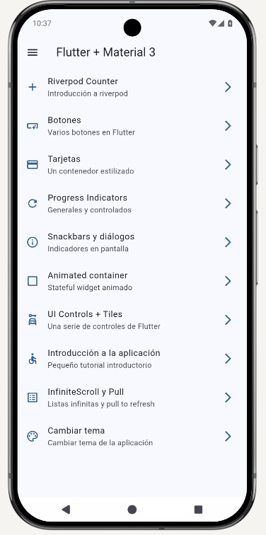 |
| **Menú Lateral (NavigationDrawer)** | Drawer lateral con categorías agrupadas (*Main* y *More options*), navegación rápida con iconos y divider. | 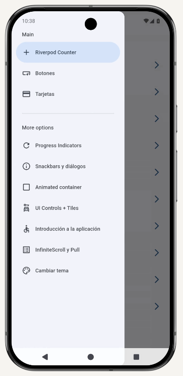 |
| **Counter Screen (Modo Claro)** | Contador reactivo implementado con Riverpod (`StateProvider`, `ConsumerWidget`, `ref.watch` y `ref.read`). | 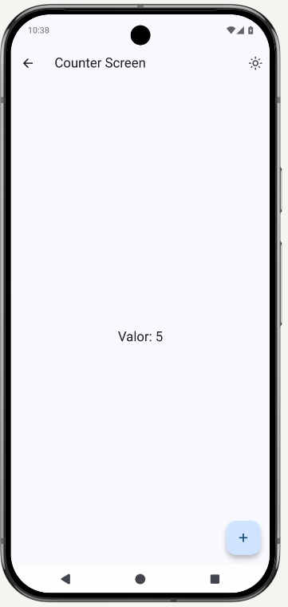 |
| **Counter Screen (Modo Oscuro)** | Alternancia dinámica al modo oscuro gestionada reactivamente a través de `themeNotifierProvider`. | 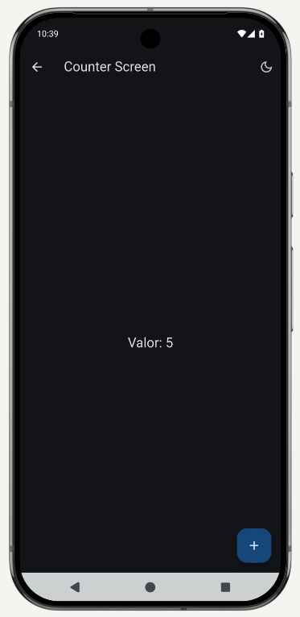 |
| **Buttons Screen** | Demostración de ElevatedButton, FilledButton, OutlinedButton, TextButton, CustomButton y FloatingActionButton. | 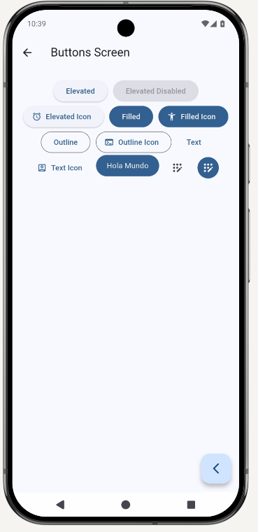 |
| **Cards Screen (Elevación y Outline)** | Tarjetas con elevación progresiva (0 a 5) y variantes con bordes redondeados y de contorno (`outline`). | 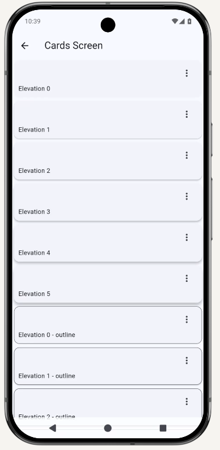 |
| **Cards Screen (Filled y Remotas)** | Tarjetas con fondo tonal (`surfaceContainerHighest`) y contenedores estilizados con imágenes remotas. | 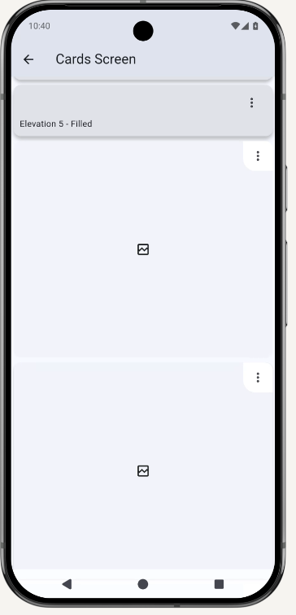 |
| **Progress Indicators** | Indicadores indeterminados y progreso circular y lineal controlado reactivamente con `StreamBuilder` y `Stream.periodic`. | 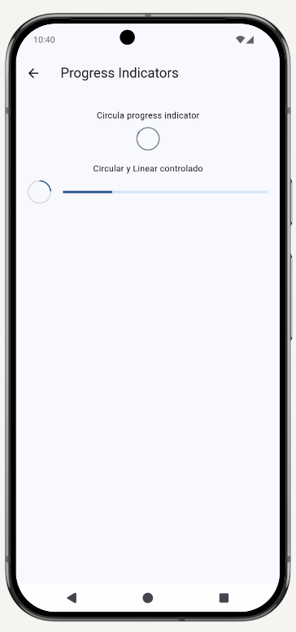 |
| **Snackbars y Diálogos** | Pantalla de retroalimentación con botones de licencias, diálogos modales y FloatingActionButton para Snackbar. | 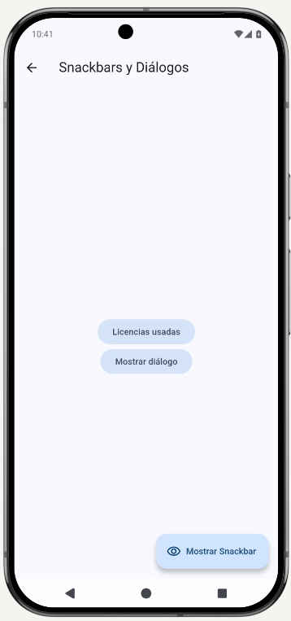 |
| **Alerta / Cuadro de Diálogo** | Implementación de `AlertDialog` con confirmación, título, contenido y botones de acción (Cancelar y Aceptar). | 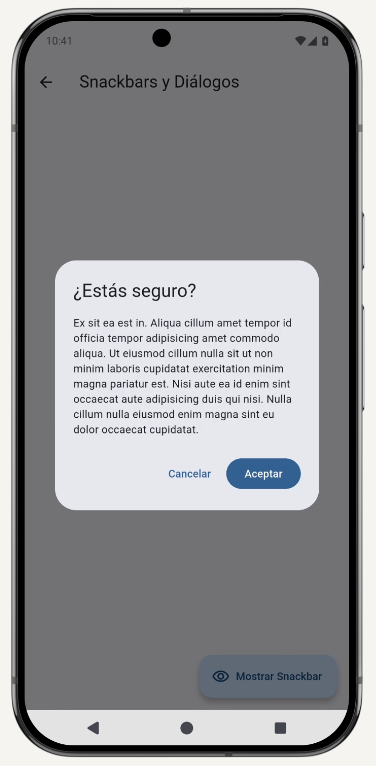 |
| **Animated Container** | Animación implícita con `AnimatedContainer`, modificando tamaño, color y radio de borde de forma aleatoria con `Random`. | 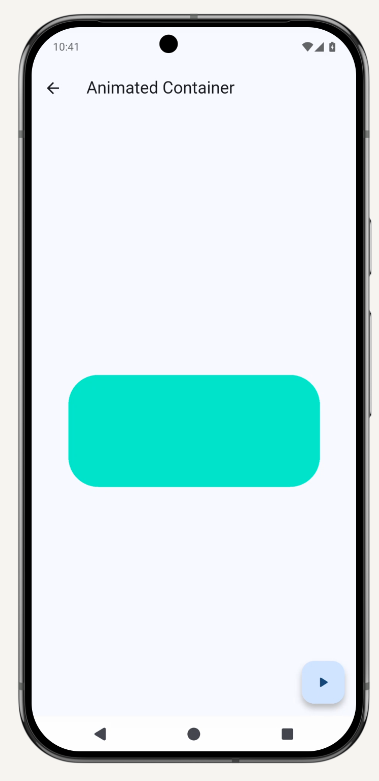 |
| **UI Controls + Tiles** | Controles interactivos de selección: `SwitchListTile` (Developer Mode), `ExpansionTile` y `CheckboxListTile`. | 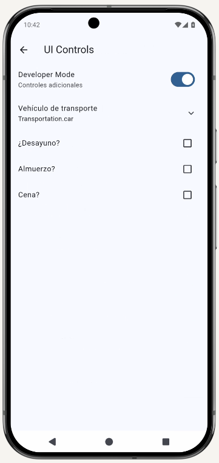 |
| **App Tutorial (Onboarding)** | Tutorial introductorio implementado con `PageView`, `PageController`, títulos, descripciones y botón de salida. | 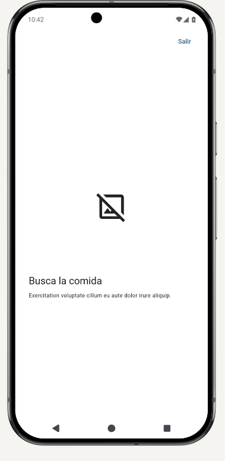 |
| **InfiniteScroll y Pull to Refresh** | Lista infinita con `ScrollController`, actualización mediante gesto *Pull to Refresh* (`RefreshIndicator`) y `FadeInImage`. | 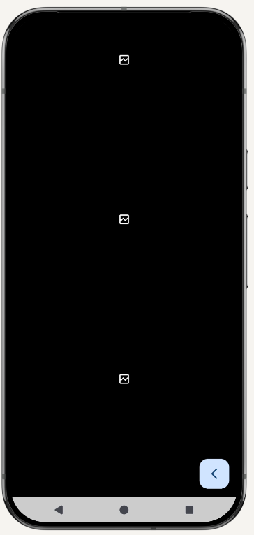 |
| **Theme Changer** | Selector dinámico del color seed principal de la aplicación mediante `RadioListTile` en tiempo real. | 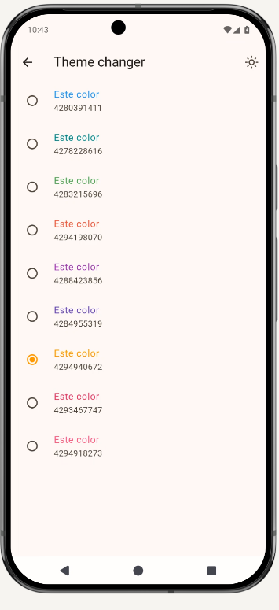 |

---

## 🏗️ Arquitectura y Estructura del Proyecto

```text
lib/
├── config/
│   ├── menu/
│   │   └── menu_items.dart          # Centralización de opciones del menú
│   ├── router/
│   │   └── app_router.dart          # Configuración GoRouter (11 rutas declarativas)
│   └── theme/
│       └── app_theme.dart           # AppTheme, paleta de colores y modo oscuro
├── presentation/
│   ├── providers/
│   │   ├── counter_provider.dart    # StateProvider para contador reactivo
│   │   └── theme_provider.dart      # StateNotifierProvider + ThemeNotifier
│   ├── screens/
│   │   ├── screens.dart             # Barrel export file
│   │   ├── home/                    # HomeScreen (/)
│   │   ├── buttons/                 # ButtonsScreen (/buttons)
│   │   ├── cards/                   # CardsScreen (/cards)
│   │   ├── progress/                # ProgressScreen (/progress)
│   │   ├── snackbar/                # SnackbarScreen (/snackbars)
│   │   ├── animated/                # AnimatedScreen (/animated)
│   │   ├── ui_controls/             # UiControlsScreen (/ui-controls)
│   │   ├── app_tutorial/            # AppTutorialScreen (/tutorial)
│   │   ├── infinite_scroll/         # InfiniteScrollScreen (/infinite)
│   │   ├── counter/                 # CounterScreen (/counter-river)
│   │   └── theme_changer/           # ThemeChangerScreen (/theme-changer)
│   └── widgets/
│       └── side_menu.dart           # NavigationDrawer con opciones agrupadas
└── main.dart                        # ProviderScope y MaterialApp.router
```

### Patrones de Software Utilizados

| Patrón / Componente | Implementación | Propósito |
|---|---|---|
| **StateProvider** | `counterProvider` | Estado global reactivo para el contador simple |
| **StateNotifierProvider** | `themeNotifierProvider` | Lógica de negocio para cambiar color seed y toggle modo oscuro |
| **ConsumerWidget** | `ref.watch()`, `ref.read()` | Reconstrucción reactiva de widgets dependientes de estado |
| **GoRouter** | Rutas declarativas y nombres | Navegación desacoplada y mantenible |
| **StreamBuilder** | `Stream.periodic` | Indicadores de progreso controlados en tiempo real |
| **StatefulWidget** | `setState()` | Control local en animaciones y selecciones de formulario |

---

## 📺 Catálogo de Pantallas Implementadas

| # | Pantalla | Ruta | Widgets Principales |
|---|---|---|---|
| 1 | **HomeScreen** | `/` | `Scaffold`, `AppBar`, `ListView.builder`, `ListTile`, `SideMenu` (`NavigationDrawer`) |
| 2 | **ButtonsScreen** | `/buttons` | `ElevatedButton`, `FilledButton`, `OutlinedButton`, `TextButton`, `IconButton`, `FloatingActionButton`, `CustomButton` (`Material` + `InkWell`) |
| 3 | **CardsScreen** | `/cards` | `Card` con elevación progresiva, bordes outline, superficie tonal (`surfaceContainerHighest`) y tarjetas con imágenes remotas |
| 4 | **ProgressScreen** | `/progress` | `CircularProgressIndicator` y `LinearProgressIndicator` (indeterminados y controlados con `StreamBuilder`) |
| 5 | **SnackbarScreen** | `/snackbars` | `ScaffoldMessenger`, `SnackBar`, `SnackBarAction`, `AlertDialog`, `showAboutDialog` |
| 6 | **AnimatedScreen** | `/animated` | `AnimatedContainer`, `Curves.elasticOut`, generación de dimensiones, colores y radio de borde aleatorios con `Random` |
| 7 | **UiControlsScreen** | `/ui-controls` | `SwitchListTile`, `RadioListTile`, `CheckboxListTile`, `ExpansionTile` con enum `Transportation` |
| 8 | **AppTutorialScreen** | `/tutorial` | `PageView`, `PageController`, `FadeInRight` del paquete `animate_do` y botón de inicio condicional |
| 9 | **InfiniteScrollScreen** | `/infinite` | `ListView.builder`, `ScrollController`, `RefreshIndicator` (Pull to Refresh), `FadeInImage` con GIF local y `SpinPerfect` |
| 10 | **CounterScreen** | `/counter-river` | `ConsumerWidget`, `counterProvider`, lectura y actualización reactiva con `ref.watch()` y `ref.read()` |
| 11 | **ThemeChangerScreen** | `/theme-changer` | `ConsumerWidget`, `themeNotifierProvider`, `RadioListTile` con paleta de colores y alternador de modo oscuro |

---

## 📦 Dependencias

```yaml
dependencies:
  flutter:
    sdk: flutter
  cupertino_icons: ^1.0.8
  go_router: ^17.5.0
  flutter_riverpod: ^3.4.3
  animate_do: ^5.1.0

dev_dependencies:
  flutter_test:
    sdk: flutter
  flutter_lints: ^6.0.0
```

---

## 🚀 Instalación y Ejecución

### Opción 1: En máquina local con Flutter

```bash
# 1. Navegar a la carpeta del proyecto
cd "Practica 5/widgets_app"

# 2. Descargar paquetes
flutter pub get

# 3. Ejecutar en emulador o dispositivo físico
flutter run

# 4. Generar APK Release
flutter build apk --release
```

### Opción 2: Sin Flutter local (Compilación en la Nube con GitHub Actions)

El proyecto cuenta con un workflow automatizado en `.github/workflows/build-apk.yml`:
1. Cada `push` a la rama `DMI-Practica05` compila automáticamente el APK en Ubuntu.
2. Puedes descargar directamente el archivo `WidgetsApp-release-apk.zip` desde la pestaña **Actions** en GitHub.
3. Para instrucciones completas, revisa [Explicacion.md](Explicacion.md).

---

## 👤 Autor

**Luis Daniel Suarez Escamilla**  
Matrícula: **230040** | Universidad Tecnológica de Xicotepec de Juárez  
Materia: **Desarrollo Móvil Integral**  
🔗 [Repositorio GitHub](https://github.com/Danny88e/Practicas-DMI-230040)

---

## 📄 Licencia

Proyecto académico desarrollado para fines educativos.
