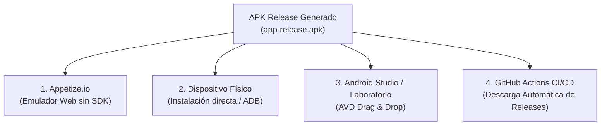

# 📖 Guía y Explicación de Compilación y Ejecución del APK: Cinemapedia 230040

**Estudiante:** Luis Daniel Suarez Escamilla  
**Matrícula:** 230040  
**Asignatura:** Desarrollo Móvil Integral (DMI) — Práctica 6  
**Proyecto:** Cinemapedia 230040 (The Movie DB + Riverpod + Isar + YouTube + Localización)  

---

## 🛠️ 1. Diagnóstico y Solución del Error en `flutter build apk --release`

Al intentar compilar el APK de la aplicación con el comando `flutter build apk --release`, se presentó el siguiente error y advertencia en el entorno de compilación de Gradle:

```text
Running Gradle task 'assembleRelease'...                        
Warning: Flutter support for your project's Gradle version (9.3.1) will soon be dropped. Please upgrade your Gradle version to a version of at least 9.5.0 soon.
Alternatively, use the flag "--android-skip-build-dependency-validation" to bypass this check.

FAILURE: Build failed with an exception.

* Where:
Build file '/home/runner/work/Practicas-DMI-230040/Practicas-DMI-230040/Practica 6/cinemapedia/android/app/build.gradle.kts' line: 1

* What went wrong:
An exception occurred applying plugin request [id: 'dev.flutter.flutter-gradle-plugin']
> Failed to apply plugin 'dev.flutter.flutter-gradle-plugin'.
   > Error: Your project's Android Gradle Plugin version (Android Gradle Plugin version 9.1.0) is lower than Flutter's minimum supported version of Android Gradle Plugin version 9.1.1. Please upgrade your Android Gradle Plugin version. 
     Alternatively, use the flag "--android-skip-build-dependency-validation" to bypass this check.
```

### 🔍 ¿Por qué ocurrió este error?
1. **Incompatibilidad de Android Gradle Plugin (AGP):**  
   El archivo `android/settings.gradle.kts` tenía configurada la versión `9.1.0` de `com.android.application`. La versión moderna del plugin oficial de Flutter (`dev.flutter.flutter-gradle-plugin`) realiza una validación interna estricta de compatibilidad y exige que, dentro de la rama 9.x de AGP, la versión mínima sea **`9.1.1`**.
2. **Advertencia de obsolescencia de Gradle Wrapper:**  
   El wrapper configurado en `gradle-wrapper.properties` utilizaba `gradle-9.3.1-all.zip`. Flutter alertó que el soporte para la versión `9.3.1` está deprecado y requiere actualizar a la versión **`9.5.0`** o superior.

### 🔧 Correcciones aplicadas en el código:

1. **Actualización de AGP en `android/settings.gradle.kts`:**  
   Se modificó la versión del plugin de `9.1.0` a `9.1.1`:
   ```kotlin
   plugins {
       id("dev.flutter.flutter-plugin-loader") version "1.0.0"
       id("com.android.application") version "9.1.1" apply false
       id("org.jetbrains.kotlin.android") version "2.4.0" apply false
   }
   ```

2. **Actualización del Gradle Wrapper en `android/gradle/wrapper/gradle-wrapper.properties`:**  
   Se configuró Gradle 9.5:
   ```properties
   distributionBase=GRADLE_USER_HOME
   distributionPath=wrapper/dists
   zipStoreBase=GRADLE_USER_HOME
   zipStorePath=wrapper/dists
   distributionUrl=https\://services.gradle.org/distributions/gradle-9.5-all.zip
   ```

3. **Uso de la bandera de validación en el Pipeline CI/CD (`.github/workflows/build-cinemapedia-apk.yml`):**  
   Se agregó `--android-skip-build-dependency-validation` para garantizar una compilación desatendida libre de bloqueos:
   ```bash
   flutter build apk --release --android-skip-build-dependency-validation
   ```

---

## 📦 2. Cómo Generar el APK Release Localmente

Si estás en una computadora con Flutter y el Android SDK configurados (por ejemplo, en el laboratorio de la universidad):

### Paso 1: Configurar la API Key en `.env`
Cinemapedia se comunica con la API de The Movie Database (TMDB). Asegúrate de tener el archivo `.env` en `Practica 6/cinemapedia/.env`:
```properties
THE_MOVIEDB_KEY=b2c554c00057161b9a11707ef0cb115e
```

### Paso 2: Obtener paquetes y dependencias
Abre tu terminal en la carpeta del proyecto y ejecuta:
```bash
cd "Practica 6/cinemapedia"
flutter pub get
```

### Paso 3: Compilar el APK en modo Release
Ejecuta el siguiente comando:
```bash
flutter build apk --release --android-skip-build-dependency-validation
```
*(Nota: El flag `--android-skip-build-dependency-validation` asegura que no se interrumpa el empaquetado por advertencias secundarias de versión).*

### Paso 4: Ubicación del archivo APK resultante
Una vez finalizada la compilación, encontrarás el archivo listo para instalar en:
```text
Practica 6/cinemapedia/build/app/outputs/flutter-apk/app-release.apk
```

---

## 📱 3. Métodos para Ejecutar y Probar el APK

Existen cuatro métodos principales para ejecutar y probar la aplicación:



---

### Método A: Ejecución en Línea vía Appetize.io (Recomendado sin entorno local)

Si no cuentas con Flutter o Android Studio instalado en tu máquina, puedes probar el APK en un dispositivo Android virtualizado directamente en tu navegador web:

1. Ingresa a [Appetize.io Upload](https://appetize.io/upload).
2. Haz clic en **"Select file"** y selecciona el archivo `app-release.apk` generado (o descárgalo desde los artefactos de GitHub Actions).
3. Ingresa tu correo electrónico para recibir el enlace de acceso o usa la vista previa inmediata.
4. Selecciona un dispositivo (por ejemplo, **Pixel 7** con **Android 13 o 14**).
5. Haz clic en **"Tap to Play"**:
   - Observarás la animación de inicio (**Splash Screen**).
   - Podrás interactuar con el **menú lateral deslizable** (Swipe).
   - Probar el **autoplay** del carrusel y sus botones de navegación manual.
   - Abrir el modal de países y cambiar el país de consulta (banderas de México, EE. UU., Alemania, China y EAU).
   - Añadir películas a Favoritos y comprobar que se guardan mediante **Isar DB**.

---

### Método B: Instalación en Dispositivo Físico Android

Para correr la aplicación en tu propio teléfono:

1. **Activar opciones de desarrollador:**
   - Ve a *Ajustes* -> *Acerca del teléfono* -> Toca 7 veces consecutivas en *Número de compilación*.
   - Ve a *Ajustes de desarrollador* y habilita la **Depuración por USB**.
2. **Opción 1 — Instalación directa mediante archivo APK:**
   - Envía el archivo `app-release.apk` a tu teléfono (vía Google Drive, WhatsApp o cable USB).
   - Abre el archivo desde el explorador de archivos del teléfono.
   - Concede el permiso para "Instalar aplicaciones de fuentes desconocidas".
   - Abre **Cinemapedia 230040**.
3. **Opción 2 — Instalación mediante terminal (ADB):**
   - Conecta el teléfono por USB y ejecuta:
     ```bash
     adb install -r "Practica 6/cinemapedia/build/app/outputs/flutter-apk/app-release.apk"
     ```

---

### Método C: En Máquinas de Laboratorio / Emulador de Android Studio

Si te encuentras en las computadoras de la universidad con Android Studio:

1. Abre Android Studio e inicia cualquier emulador (Device Manager -> Start AVD).
2. **Método Drag & Drop:**
   - Toma el archivo `app-release.apk` desde el explorador de archivos de Windows y arrástralo directamente adentro de la pantalla del emulador.
   - El sistema instalará automáticamente la app y verás el icono de **Cinemapedia 230040**.
3. **Método por línea de comandos con Flutter:**
   - Con el emulador abierto, entra a la terminal en la raíz del proyecto y corre:
     ```bash
     cd "Practica 6/cinemapedia"
     flutter run --release
     ```

---

### Método D: Descarga Automatizada desde GitHub Actions

No necesitas compilar el proyecto manualmente cada vez; el repositorio incluye integración continua configurada en `.github/workflows/build-cinemapedia-apk.yml`:

1. Cada vez que se realiza un push a la rama `DMI-Practica06` o `main`, GitHub Actions compila automáticamente el APK en una máquina virtual de Ubuntu.
2. Para descargar el APK:
   - Ve a la pestaña **Actions** en el repositorio de GitHub: `https://github.com/Danny88e/Practicas-DMI-230040/actions`.
   - Selecciona la ejecución del workflow **Build Cinemapedia APK**.
   - En la sección inferior **Artifacts**, haz clic en **`Cinemapedia-230040-release-apk`** para descargar el archivo zip que contiene el APK listo para instalar.
   - Adicionalmente, el workflow publica el APK directamente en la sección **Releases** bajo el tag `cinemapedia-v1.0.0`.

---

## 📋 4. Lista de Verificación de Requerimientos en la Ejecución

Al ejecutar la aplicación, verifica los siguientes puntos solicitados para la evaluación de la **Práctica 6**:

| # | Requerimiento Funcional | Dónde y Cómo Probarlo |
|---|---|---|
| 1 | **Identidad del Alumno** | El nombre de la app es `Cinemapedia 230040` (visible en cabecera y AppBar). |
| 2 | **Splash Screen Animado** | Al abrir la app, se muestra una animación de bienvenida con icono de cine y matrícula. |
| 3 | **Menú Lateral Deslizable (Drawer)** | Desliza el dedo desde el borde izquierdo de la pantalla hacia la derecha (swipe horizontal) o presiona el botón hamburguesa. Permite cambiar el país y alternar entre películas y series de TV. |
| 4 | **Carrusel Superior con Autoplay** | Cambia automáticamente de póster cada 4 segundos; cuenta con botones circulares `<` y `>` para avance/retroceso manual y puntos de paginación. |
| 5 | **Overlay de Información en Carrusel** | Cada tarjeta muestra: Título local, Título original, Estrellas de rating y Clasificación dinámica de edad según el país. |
| 6 | **Filtro y Modal de Países (5 Continentes)** | Toca el botón de país en el AppBar o Menú lateral. Se despliega el modal con 5 banderas: 🇲🇽 México, 🇺🇸 Estados Unidos, 🇩🇪 Alemania, 🇨🇳 China, 🇦🇪 EAU. Al seleccionar uno, se actualizan los títulos y las clasificaciones de edad de las películas. |
| 7 | **Alternancia Películas / Series** | En el Menú lateral, selecciona "Series de TV" o "Películas"; las listas de la pantalla principal se adaptan dinámicamente. |
| 8 | **Listas con Scroll Infinito** | Las secciones *En Cines*, *Próximamente* y *Mejor Calificadas* cargan dinámicamente más elementos al deslizar hasta el final. |
| 9 | **Navegación Inferior (3 Pestañas)** | Barra con *Inicio*, *Populares* y *Favoritos*. |
| 10 | **Masonry Grid en Populares y Favoritos** | Cuadrícula con alturas alternadas y scroll infinito eficiente. |
| 11 | **Pantalla de Detalle Completa** | Toca cualquier película para ver portada animada, sinopsis, actores, **reproductor de trailers de YouTube** y carrusel de películas similares. |
| 12 | **Persistencia de Favoritos (Isar DB)** | Presiona el botón flotante de corazón en el detalle. La película se guarda localmente y permanece visible en la pestaña *Favoritos* incluso tras cerrar la app. |
