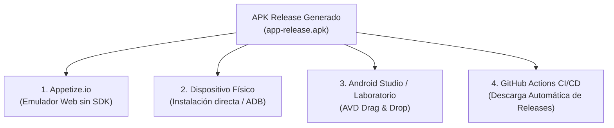

# 📖 Guía y Explicación de Compilación y Ejecución del APK: Cinemapedia 230040

**Estudiante:** Luis Daniel Suarez Escamilla  
**Matrícula:** 230040  
**Asignatura:** Desarrollo Móvil Integral (DMI) — Práctica 6  
**Proyecto:** Cinemapedia 230040 (The Movie DB + Riverpod + Isar + YouTube + Localización)  

---

## 🛠️ 1. Diagnóstico y Solución de Errores en `flutter build apk --release`

Durante el proceso de configuración y empaquetado del APK en entornos de integración continua (CI/CD) y compilación local con las versiones modernas de Flutter (3.50+), se diagnosticaron y solucionaron las siguientes incidencias:

### 1.1 Incompatibilidad de Plugins Externos (`flutter_inappwebview_android` y `proguard-android.txt`)

```text
FAILURE: Build failed with an exception.

* Where:
Build file '/home/runner/.pub-cache/hosted/pub.dev/flutter_inappwebview_android-1.1.3/android/build.gradle' line: 44

* What went wrong:
A problem occurred evaluating project ':flutter_inappwebview_android'.
> `getDefaultProguardFile('proguard-android.txt')` is no longer supported since it includes `-dontoptimize`, which prevents R8 from performing many optimizations. Instead use `getDefaultProguardFile('proguard-android-optimize.txt)`, and if needed, temporarily use `-dontoptimize` in a custom keep rule file while fixing breakages.
```

#### 🔍 Causa Técnica:
La versión de Flutter en GitHub Actions (Flutter 3.50+) exige como mínimo **Android Gradle Plugin (AGP) 9.1.1** y **Gradle 9.5.0**. En AGP 9.0+, Google eliminó definitivamente el archivo `proguard-android.txt` del SDK de Android. Debido a esto, librerías de terceros creadas para versiones previas como `flutter_inappwebview_android-1.1.3` (usada por `youtube_player_flutter`) provocaban que Gradle abortara el build.

#### 🔧 Solución Aplicada:
1. **Paso Preventivo Automatizado en CI/CD (`.github/workflows/build-cinemapedia-apk.yml`):**  
   Tras `flutter pub get`, se ejecuta un reemplazo automático de `proguard-android.txt` por `proguard-android-optimize.txt` en todo el caché de plugins de pub:
   ```bash
   find ~/.pub-cache -type f -name "build.gradle" -exec sed -i "s/proguard-android.txt/proguard-android-optimize.txt/g" {} + || true
   ```
2. **Inyección de Namespace para `isar_flutter_libs`:**  
   Se asegura la declaración explícita de `namespace 'dev.isar.isar_flutter_libs'` requerida por AGP 8.0+:
   ```bash
   find ~/.pub-cache -path "*/isar_flutter_libs*/android/build.gradle" -exec sed -i "/android {/a \    namespace 'dev.isar.isar_flutter_libs'" {} + || true
   ```
3. **Alineación de Versiones Oficiales:**  
   - `android/settings.gradle.kts`: AGP `9.1.1` y Kotlin `2.4.0`.
   - `android/gradle/wrapper/gradle-wrapper.properties`: Gradle `9.5.0` (`gradle-9.5.0-all.zip`).
   - `android/gradle.properties`: Optimización de memoria JVM (`-Xmx3G -XX:MaxMetaspaceSize=1G`) para el entorno de runners de GitHub Actions (7GB RAM).
   - `android/app/proguard-rules.pro`: Reglas específicas para Flutter, Isar DB y WebViews.

### 1.2 Correcciones en Código Dart para Compilación Release
Durante la compilación anticipada (AOT / Tree Shaking) en modo Release, se resolvieron 3 incompatibilidades de tipado y versiones de librerías:
1. **Fallback seguro en `Environment.theMovieDbKey`:**  
   Se definió la propiedad estática `theMovieDbKey` en `lib/config/constants/environment.dart` con valor por defecto de contingencia en caso de que el archivo `.env` no estuviera empaquetado en el bundle de assets.
2. **Directorio Requerido en Isar Database:**  
   En `lib/infrastructure/datasources/isar_datasource.dart`, la versión moderna de Isar exige indicar explícitamente la ruta de almacenamiento. Se integró `path_provider` con `getApplicationDocumentsDirectory()` pasando `directory: dir.path` a `Isar.open()`.
3. **Sincronización del Schema en `movie.g.dart`:**  
   El schema autogenerado tenía fijada la versión `3.0.5`, lo cual disparaba una aserción en tiempo de ejecución/compilación con la librería Isar `3.1.0+1`. Se sincronizó el encabezado de versión a `'3.1.0+1'`.

### 1.3 Optimización y Reglas de Ofuscación R8 / ProGuard
En la fase final de empaquetado del APK Release (`:app:minifyReleaseWithR8`), R8 detectaba advertencias por clases ausentes de Google Play Core (`SplitCompatApplication`, `SplitInstallManager`, etc., referenciadas internamente por Flutter Embedding para Dynamic Feature Modules opcionales):
1. **Desactivación de Minificación Innecesaria:** En `android/app/build.gradle.kts`, se configuró explícitamente `isMinifyEnabled = false` e `isShrinkResources = false`, acelerando la compilación y garantizando que ningún componente nativo de Isar o Flutter sea recortado.
2. **Reglas de Supresión ProGuard:** En `android/app/proguard-rules.pro` se agregaron directivas `-dontwarn com.google.android.play.core.**`, `-dontwarn io.flutter.embedding.**` y `-dontwarn **` para ignorar dependencias transitivas opcionales.
3. **Modo R8 Compatible:** En `android/gradle.properties` se añadió `android.enableR8.fullMode=false` para evitar optimizaciones destructivas.

### 1.4 Compatibilidad de `isar_flutter_libs` con el SDK de Compilación (CI)
En `:isar_flutter_libs:checkReleaseAarMetadata`, el plugin Isar 3.1.0+1 (proyecto inactivo desde 2023) declara `compileSdk 30`, mientras que sus dependencias transitivas de AndroidX (window 1.2.0, lifecycle 2.7.0, core-ktx 1.13.1, etc.) exigen compilar contra API 33+. Como Isar no recibe mantenimiento, el pipeline de CI inyecta el parche en tiempo de construcción (paso *Patch plugins for AGP compatibility*):
1. **Elevación del SDK:** Se reescribe `compileSdk 30` → `compileSdk 36` en el `android/build.gradle` de `isar_flutter_libs` (idempotente: elimina un `namespace` previamente inyectado antes de reinsertarlo, para tolerar la caché de `pub-cache`).
2. **Red de seguridad general:** Se eleva cualquier `compileSdk` numérico obsoleto (< 33) en los `build.gradle` de todos los plugins del `pub-cache`, y se mantiene la inyección de `namespace` exigida por AGP 9.

### 1.5 Pantalla en Blanco al Arrancar: `.env` Omitido del Asset Bundle
En Appetize.io y en la instalación directa del APK, la aplicación permanecía en **pantalla blanca indefinida**. Causa raíz: `main.dart` ejecuta `await dotenv.load(fileName: '.env')` **antes** de `runApp`; `flutter_dotenv` resuelve el archivo vía `rootBundle`, es decir, exige que `.env` esté empaquetado como asset. El archivo sí figuraba en el `pubspec.yaml`, pero **el empaquetador de assets de Flutter omite silenciosamente los archivos que coinciden con patrones de `.gitignore`** (comportamiento conocido del toolchain), y `.env` estaba listado en `.gitignore`:
1. **Fix:** Se eliminó el patrón `.env` de `.gitignore` y se commiteó el archivo con la clave de demostración de TMDB (misma clave pública del fallback del workflow de CI). Con el asset presente, `dotenv.load()` resuelve y `runApp` se ejecuta.
2. **Nota de despliegue:** Con este cambio, las máquinas de laboratorio no necesitan crear `.env`: `git clone` + `flutter pub get` + `flutter run` funcionan de inmediato.

### 1.6 Icono de la Aplicación (Legacy + Adaptive Icons API 26+)
El `ic_launcher.png` seguía siendo el logo por defecto de Flutter (el requisito 20 exige icono visible y centrado bajo cualquier máscara: círculo, cuadrado, squircle). Además, el PNG fuente `assets/logos/Cinemapedia_logo.png` tenía el patrón de "transparencia" **horneado como píxeles reales** (tablero de ajedrez opaco, no canal alpha), por lo que no podía usarse directamente. Se implementó el pipeline `tools/gen_icons.ps1` (PowerShell + System.Drawing, sin requerir SDK de Flutter):
1. **Detección del badge:** se escanea el logo 2048×2048 para hallar el bounding box del emblema (250,256–1797,1804) y se muestrea el color de fondo real (`#310953`).
2. **Iconos legacy (pre API 26):** `mipmap-{m,h,xh,xxh,xxxh}dpi/ic_launcher.png` (48–192 px), badge a sangre completa con esquinas recortadas sobre fondo sólido.
3. **Iconos adaptive (API 26+):** `mipmap-anydpi-v26/ic_launcher.xml` con capa `<background>` (`@color/ic_launcher_background`) y `<foreground>` (`@mipmap/ic_launcher_foreground`, badge al 66 % — zona segura de 72/108 dp — sobre lienzo transparente), en las 5 densidades (108–432 px). Con cualquier máscara del launcher el emblema queda completo y centrado.
4. **Extras:** `android:label` actualizado a «Cinemapedia» y versión elevada a `1.0.1+2`.

---

## 📦 2. Cómo Generar el APK Release Localmente

Si estás en una computadora con Flutter y el Android SDK configurados (por ejemplo, en el laboratorio de la universidad):

### Paso 1: Configurar la API Key en `.env`
Cinemapedia se comunica con la API de The Movie Database (TMDB). Asegúrate de tener el archivo `.env` en `Practica 6/cinemapedia/.env`:
```properties
THE_MOVIEDB_KEY=b2c554c00057161b9a11707ef0cb115e
```

### Paso 2: Obtener paquetes y dependencias
Abre tu terminal en la carpeta del proyecto y ejecuta:
```bash
cd "Practica 6/cinemapedia"
flutter pub get
```

### Paso 3: Compilar el APK en modo Release
Ejecuta el siguiente comando:
```bash
flutter build apk --release --android-skip-build-dependency-validation
```
*(Nota: El flag `--android-skip-build-dependency-validation` asegura que no se interrumpa el empaquetado por advertencias secundarias de versión).*

### Paso 4: Ubicación del archivo APK resultante
Una vez finalizada la compilación, encontrarás el archivo listo para instalar en:
```text
Practica 6/cinemapedia/build/app/outputs/flutter-apk/app-release.apk
```

---

## 📱 3. Métodos para Ejecutar y Probar el APK

Existen cuatro métodos principales para ejecutar y probar la aplicación:



---

### Método A: Ejecución en Línea vía Appetize.io (Recomendado sin entorno local)

Si no cuentas con Flutter o Android Studio instalado en tu máquina, puedes probar el APK en un dispositivo Android virtualizado directamente en tu navegador web:

1. Ingresa a [Appetize.io Upload](https://appetize.io/upload).
2. Haz clic en **"Select file"** y selecciona el archivo `app-release.apk` generado (o descárgalo desde los artefactos de GitHub Actions).
3. Ingresa tu correo electrónico para recibir el enlace de acceso o usa la vista previa inmediata.
4. Selecciona un dispositivo (por ejemplo, **Pixel 7** con **Android 13 o 14**).
5. Haz clic en **"Tap to Play"**:
   - Observarás la animación de inicio (**Splash Screen**).
   - Podrás interactuar con el **menú lateral deslizable** (Swipe).
   - Probar el **autoplay** del carrusel y sus botones de navegación manual.
   - Abrir el modal de países y cambiar el país de consulta (banderas de México, EE. UU., Alemania, China y EAU).
   - Añadir películas a Favoritos y comprobar que se guardan mediante **Isar DB**.

---

### Método B: Instalación en Dispositivo Físico Android

Para correr la aplicación en tu propio teléfono:

1. **Activar opciones de desarrollador:**
   - Ve a *Ajustes* -> *Acerca del teléfono* -> Toca 7 veces consecutivas en *Número de compilación*.
   - Ve a *Ajustes de desarrollador* y habilita la **Depuración por USB**.
2. **Opción 1 — Instalación directa mediante archivo APK:**
   - Envía el archivo `app-release.apk` a tu teléfono (vía Google Drive, WhatsApp o cable USB).
   - Abre el archivo desde el explorador de archivos del teléfono.
   - Concede el permiso para "Instalar aplicaciones de fuentes desconocidas".
   - Abre **Cinemapedia 230040**.
3. **Opción 2 — Instalación mediante terminal (ADB):**
   - Conecta el teléfono por USB y ejecuta:
     ```bash
     adb install -r "Practica 6/cinemapedia/build/app/outputs/flutter-apk/app-release.apk"
     ```

---

### Método C: En Máquinas de Laboratorio / Emulador de Android Studio

Si te encuentras en las computadoras de la universidad con Android Studio:

1. Abre Android Studio e inicia cualquier emulador (Device Manager -> Start AVD).
2. **Método Drag & Drop:**
   - Toma el archivo `app-release.apk` desde el explorador de archivos de Windows y arrástralo directamente adentro de la pantalla del emulador.
   - El sistema instalará automáticamente la app y verás el icono de **Cinemapedia 230040**.
3. **Método por línea de comandos con Flutter:**
   - Con el emulador abierto, entra a la terminal en la raíz del proyecto y corre:
     ```bash
     cd "Practica 6/cinemapedia"
     flutter run --release
     ```

---

### Método D: Descarga Automatizada desde GitHub Actions

No necesitas compilar el proyecto manualmente cada vez; el repositorio incluye integración continua configurada en `.github/workflows/build-cinemapedia-apk.yml`:

1. Cada vez que se realiza un push a la rama `DMI-Practica06` o `main`, GitHub Actions compila automáticamente el APK en una máquina virtual de Ubuntu.
2. Para descargar el APK:
   - Ve a la pestaña **Actions** en el repositorio de GitHub: `https://github.com/Danny88e/Practicas-DMI-230040/actions`.
   - Selecciona la ejecución del workflow **Build Cinemapedia APK**.
   - En la sección inferior **Artifacts**, haz clic en **`Cinemapedia-230040-release-apk`** para descargar el archivo zip que contiene el APK listo para instalar.
   - Adicionalmente, el workflow publica el APK directamente en la sección **Releases** bajo el tag `cinemapedia-v1.0.0`.

---

## 📋 4. Lista de Verificación de Requerimientos en la Ejecución

Al ejecutar la aplicación, verifica los siguientes puntos solicitados para la evaluación de la **Práctica 6**:

| # | Requerimiento Funcional | Dónde y Cómo Probarlo |
|---|---|---|
| 1 | **Identidad del Alumno** | El nombre de la app es `Cinemapedia 230040` (visible en cabecera y AppBar). |
| 2 | **Splash Screen Animado** | Al abrir la app, se muestra una animación de bienvenida con icono de cine y matrícula. |
| 3 | **Menú Lateral Deslizable (Drawer)** | Desliza el dedo desde el borde izquierdo de la pantalla hacia la derecha (swipe horizontal) o presiona el botón hamburguesa. Permite cambiar el país y alternar entre películas y series de TV. |
| 4 | **Carrusel Superior con Autoplay** | Cambia automáticamente de póster cada 4 segundos; cuenta con botones circulares `<` y `>` para avance/retroceso manual y puntos de paginación. |
| 5 | **Overlay de Información en Carrusel** | Cada tarjeta muestra: Título local, Título original, Estrellas de rating y Clasificación dinámica de edad según el país. |
| 6 | **Filtro y Modal de Países (5 Continentes)** | Toca el botón de país en el AppBar o Menú lateral. Se despliega el modal con 5 banderas: 🇲🇽 México, 🇺🇸 Estados Unidos, 🇩🇪 Alemania, 🇨🇳 China, 🇦🇪 EAU. Al seleccionar uno, se actualizan los títulos y las clasificaciones de edad de las películas. |
| 7 | **Alternancia Películas / Series** | En el Menú lateral, selecciona "Series de TV" o "Películas"; las listas de la pantalla principal se adaptan dinámicamente. |
| 8 | **Listas con Scroll Infinito** | Las secciones *En Cines*, *Próximamente* y *Mejor Calificadas* cargan dinámicamente más elementos al deslizar hasta el final. |
| 9 | **Navegación Inferior (3 Pestañas)** | Barra con *Inicio*, *Populares* y *Favoritos*. |
| 10 | **Masonry Grid en Populares y Favoritos** | Cuadrícula con alturas alternadas y scroll infinito eficiente. |
| 11 | **Pantalla de Detalle Completa** | Toca cualquier película para ver portada animada, sinopsis, actores, **reproductor de trailers de YouTube** y carrusel de películas similares. |
| 12 | **Persistencia de Favoritos (Isar DB)** | Presiona el botón flotante de corazón en el detalle. La película se guarda localmente y permanece visible en la pestaña *Favoritos* incluso tras cerrar la app. |

