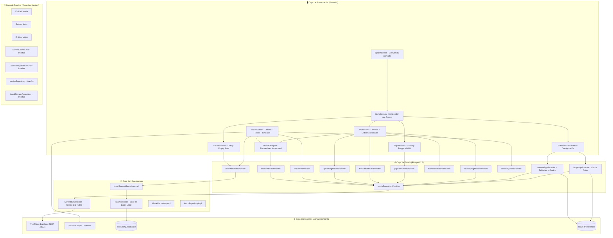

# 🎬 Cinemapedia 230040 — Práctica 6

**Estudiante:** Luis Daniel Suarez Escamilla  
**Matrícula:** 230040  
**Materia:** Desarrollo Móvil Integral (DMI)  
**Institución:** Universidad Tecnológica de Xicotepec de Juárez  
**Repositorio Oficial:** [GitHub - Danny88e/Practicas-DMI-230040](https://github.com/Danny88e/Practicas-DMI-230040)

---

## 📱 Descripción General

**Cinemapedia 230040** es una aplicación móvil de alto rendimiento desarrollada en **Flutter** con arquitectura limpia (Clean Architecture) y gestión reactiva de estado con **Riverpod**. Se conecta directamente con los servicios REST de **The Movie Database (TMDB)** para proporcionar consulta, búsqueda y visualización de películas y series de televisión, con persistencia local mediante base de datos **Isar**, reproductor de tráilers de YouTube y soporte de internacionalización dinámica en 5 idiomas.

---

## ✨ Funcionalidades Implementadas

| # | Módulo / Requerimiento | Descripción Técnica | Estado |
|---|------------------------|---------------------|:------:|
| 1 | **Splash Screen animado** | Pantalla de inicio elegante con transiciones `animate_do` y navegación automática a `/home/0`. | ✅ |
| 2 | **Carga inicial fluida** | `FullScreenLoader` con mensajes animados mientras se sincronizan los datos de TMDB. | ✅ |
| 3 | **Carrusel Autoplay de Estrenos** | Swiper superior con autoplay, controles manuales de avance/retroceso y paginación por puntos. | ✅ |
| 4 | **Overlay informativo en Carrusel** | Tarjetas con título local, título original, estrellas numéricas y clasificación de edad adaptativa. | ✅ |
| 5 | **Listas Horizontales con Scroll Infinito** | Secciones *En cines*, *Próximamente* y *Mejor calificadas* con detección de gestos `ScrollNotification`. | ✅ |
| 6 | **Barra de Navegación Inferior** | `CustomBottomNavigation` con pestañas (*Inicio*, *Populares*, *Favoritos*) y etiquetas multi-idioma. | ✅ |
| 7 | **Vista Populares en Masonry Grid** | `MovieMasonry` con cuadrícula escalonada (Staggered Grid) y paginación infinita automática. | ✅ |
| 8 | **Pantalla de Detalle de Película/Serie** | `MovieScreen` con póster expandido, título, sinopsis completa, fecha de estreno y chips de género. | ✅ |
| 9 | **Reparto y Tráiler de YouTube** | Listado horizontal de actores principales y reproductor interactivo de YouTube (`youtube_player_flutter`). | ✅ |
| 10 | **Películas y Series Similares** | Carrusel inferior de recomendaciones con navegación encadenada a nuevos detalles. | ✅ |
| 11 | **Clasificación de Edad Localizada** | Etiqueta dinámica de clasificación según sistema del país (México: B15/AA, EE.UU.: PG-13/R, Alemania: FSK 12, etc.). | ✅ |
| 12 | **Búsqueda en Tiempo Real** | `SearchMovieDelegate` con debounce de 500ms, sugerencias instantáneas y acceso al detalle. | ✅ |
| 13 | **Sistema de Favoritos** | Botón de corazón reactivo con animación y vista de estado vacío con acceso directo al buscador. | ✅ |
| 14 | **Persistencia de Favoritos (Isar DB)** | Base de datos local NoSQL embebida de alta velocidad (`IsarDatabase`) que preserva datos entre reinicios. | ✅ |
| 15 | **Menú Lateral (Drawer) con Swipe** | `SideMenu` deslizable desde el borde izquierdo o botón hamburguesa con acceso a configuración. | ✅ |
| 16 | **Cambio de Idioma Global** | Selector interactivo para **Español 🇲🇽, Inglés 🇺🇸, Alemán 🇩🇪, Chino 🇨🇳 y Árabe 🇸🇦**. | ✅ |
| 17 | **Persistencia de Idioma** | Preferencia de idioma almacenada y restaurada permanentemente con `SharedPreferences`. | ✅ |
| 18 | **Políticas de Respaldo y RTL** | Respaldo automático al inglés si falta sinopsis; soporte de dirección de texto árabe sin romper la UI. | ✅ |
| 19 | **Conmutador Películas ↔ Series** | Selector de tipo de contenido en Configuración que adapta el inicio, populares y búsquedas dinámicamente. | ✅ |
| 20 | **Empaquetado y Automatización APK** | Iconos adaptables configurados y flujo de CI/CD con GitHub Actions para generar el APK Release. | ✅ |

---

## 🏗️ Arquitectura del Sistema



---

## 📂 Estructura Limpia del Proyecto

```
lib/
├── config/
│   ├── constants/
│   │   ├── app_languages.dart       # Definición de idiomas y códigos TMDB
│   │   ├── app_localizations.dart   # Diccionario multilingüe y clasificaciones por edad
│   │   └── environment.dart         # Variables de entorno (.env)
│   ├── helpers/
│   │   └── human_formats.dart       # Formato legible de fechas y ratings
│   ├── router/
│   │   └── app_router.dart          # Configuración declarativa con GoRouter
│   └── theme/
│       └── app_theme.dart           # Tema Material 3 adaptativo
├── domain/
│   ├── datasources/                 # Contratos de orígenes de datos
│   ├── entities/                    # Modelos de negocio puros (Movie, Actor, Video)
│   └── repositories/                # Contratos de repositorios
├── infrastructure/
│   ├── datasources/
│   │   ├── moviedb_datasource.dart  # Cliente TMDB con respaldo al inglés y series
│   │   ├── isar_datasource.dart     # Persistencia local NoSQL con Isar
│   │   └── actor_moviedb_datasource.dart
│   ├── mappers/                     # Mapeo de modelos API a entidades de dominio
│   ├── models/                      # Modelos JSON de TMDB
│   └── repositories/                # Implementaciones de repositorios
├── presentation/
│   ├── delegates/
│   │   └── search_movie_delegate.dart # Búsqueda en tiempo real con debounce
│   ├── providers/
│   │   ├── language/                # Providers de idioma y conmutador series/películas
│   │   ├── movies/                  # Providers de estrenos, populares, slideshow
│   │   ├── actors/                  # Providers de actores
│   │   ├── search/                  # Providers de consulta de búsqueda
│   │   └── storage/                 # Providers de favoritos e Isar DB
│   ├── screens/
│   │   ├── splash/
│   │   │   └── splash_screen.dart   # Splash Screen animado
│   │   └── movies/
│   │       ├── home_screen.dart     # Scaffold con Navigation Drawer
│   │       └── movie_screen.dart    # Pantalla de detalle con trailer y reparto
│   ├── views/
│   │   └── movies/
│   │       ├── home_view.dart       # Vista de inicio (Carrusel + 3 listas)
│   │       ├── popular_view.dart    # Vista de populares (Masonry Grid)
│   │       └── favorites_view.dart  # Vista de favoritos con Empty State
│   └── widgets/
│       ├── actors/                  # Widgets de reparto
│       ├── movies/                  # Carrusel, masonry, enlaces de póster
│       ├── shared/                  # AppBar, BottomNav, SideMenu Drawer, Loader
│       └── videos/                  # Reproductor interactivo de YouTube
└── main.dart                        # Punto de entrada con inicialización de SharedPreferences
```

---

## 🌍 Sistema Global de Idiomas y Clasificación

| Código | Bandera | Idioma | Código TMDB | Sistema de Clasificación |
|:------:|:-------:|:-------|:-----------:|:-------------------------|
| `es` | 🇲🇽 | Español | `es-MX` | México: AA, A, B, B15, C |
| `en` | 🇺🇸 | English | `en-US` | USA: G, PG, PG-13, R, NC-17 |
| `de` | 🇩🇪 | Deutsch | `de-DE` | Alemania: FSK 0, FSK 6, FSK 12, FSK 16, FSK 18 |
| `zh` | 🇨🇳 | 中文 | `zh-CN` | China / Taiwán: 普遍级, 保护级, 辅导级, 限制级 |
| `ar` | 🇸🇦 | العربية | `ar-SA` | Países Árabes: G, PG, PG12, 15+, 18+ |

- **Respaldo automático al inglés:** Si TMDB no cuenta con sinopsis en el idioma seleccionado (ej. alemán o árabe para una película regional), se solicita automáticamente la versión en inglés (`en-US`) evitando campos vacíos.
- **Soporte de texto árabe (RTL):** Los títulos y sinopsis en árabe se renderizan con dirección de texto `TextDirection.rtl`, mientras que la interfaz general mantiene estabilidad sin voltear botones ni drawers de forma invertida.

---

## 🚀 Guía de Ejecución y Pruebas sin SDK Local

Si no dispones del SDK de Flutter instalado en tu equipo, puedes compilar, probar y verificar la aplicación mediante cualquiera de las siguientes alternativas gratuitas:

### Opción 1: Compilación Automatizada en la Nube (GitHub Actions)
El repositorio cuenta con el flujo automatizado `.github/workflows/build-cinemapedia-apk.yml`:
1. Ingresa a la pestaña **Actions** en el repositorio GitHub.
2. Selecciona el workflow **Build Cinemapedia APK**.
3. Haz clic en **Run workflow** sobre la rama `main` o `DMI-Practica06`.
4. Al finalizar la compilación (aprox. 3 minutos), descarga el archivo `Cinemapedia-230040-release-apk` en la sección **Artifacts** o desde **Releases**.

### Opción 2: Emulación Online en Appetize.io
1. Descarga el archivo `app-release.apk` generado por GitHub Actions.
2. Ingresa a [Appetize.io Upload](https://appetize.io/upload).
3. Sube el archivo `.apk` y obtén de inmediato un emulador Android interactivo ejecutable desde cualquier navegador web sin instalar nada en tu computadora.

### Opción 3: Ejecución en Equipos de Laboratorio Universitario
Una vez clonado el repositorio en una máquina con Flutter:
```bash
# 1. Navegar a la carpeta del proyecto
cd "Practica 6/cinemapedia"

# 2. Configurar la clave de TMDB en .env
echo "THE_MOVIEDB_KEY=tu_clave_de_tmdb" > .env

# 3. Obtener paquetes y dependencias
flutter pub get

# 4. Compilar y ejecutar en modo debug
flutter run

# 5. Generar APK Release listo para entrega
flutter build apk --release
```

---

## 🔗 Enlaces del Proyecto

- **Demostración en Línea (Appetize.io):** [Ver demostración interactiva](https://appetize.io/app/b_zfiayvtvlc5z7luikybxifpw7e)
- **Documentación Interactiva en GitHub Pages:** [https://danny88e.github.io/Practicas-DMI-230040/](https://danny88e.github.io/Practicas-DMI-230040/)

---

## 📊 Estrategia de Control de Versiones (Git)

Siguiendo la política de entrega estricta (**cero commits directos en `main`**), todo el desarrollo se estructuró lógicamente a través de ramas de características y fusiones:

```
main
 └── DMI-Practica06 (Feature Branch)
      ├── feat(ci): cambiar nombre de app a Cinemapedia 230040 y agregar logo
      ├── feat(ui): agregar menu lateral con soporte de swipe
      ├── feat(gestos): detectar inicio y fin de scroll en listas horizontales
      ├── feat(carousel): overlay con rating y clasificacion de edad
      ├── feat(country): configuracion de pais con modal interactivo
      ├── chore(deps): limpiar dependencias pubspec, agregar isar y shared_preferences
      ├── feat(i18n): sistema de idiomas global con persistencia (ES/EN/DE/ZH/AR)
      ├── feat(nav): splash screen animado, drawer con swipe y navegacion
      ├── feat(carousel): overlay con titulo original, estrellas y scroll gestures
      ├── feat(i18n): diccionario multilingue completo y toggle peliculas/series
      ├── feat(detail): pantalla de detalle con trailer youtube y similares
      ├── feat(storage): persistencia local de favoritos con Isar DB y masonry grid
      └── docs(readme): documentacion completa con diagrama mermaid y guia sin SDK
```

---

## 👨‍💻 Autor

**Luis Daniel Suarez Escamilla**  
Matrícula: **230040**  
Materia: Desarrollo Móvil Integral (DMI)  
Carrera: Ingeniería en Tecnologías de la Información y Comunicación
